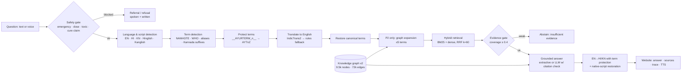

# Architecture

| Layer | Code |
|---|---|
| Config & flags | `app/config.py` (`.env` supported) |
| Safety | `app/core/safety.py`, `app/core/symptom_mapper.py` |
| Terminology | `app/core/terminology.py`, `matcher.py`, `protection.py` |
| Translation | `app/pipeline/translator.py` (rules), `translator_neural.py` (IndicTrans2 + cache) |
| Retrieval | `bm25_retriever.py`, `dense_retriever.py` (sentence-transformers / TF-IDF), `hybrid_retriever.py`, `index_cache.py` |
| Generation | `generator.py` (extractive), `llm_generator.py` (optional) |
| Graph | `app/core/who_extract.py`, `kg_builder.py`, `kg_v2.py` (v1: `knowledge_graph.py`) |
| Herbs/lifestyle | `app/core/herbs.py` |
| Voice | `app/voice/{stt,tts,text_clean}.py` |
| API | `api/main.py` (FastAPI) |
| Website | `frontend/` (no build step) · legacy `web/app.py` (Streamlit) |
| Evaluation | `app/evaluation/{evaluator_v2,go_no_go_probe_v2,report_v2,human_eval_kit,kappa}.py` (v1 files unchanged) |
